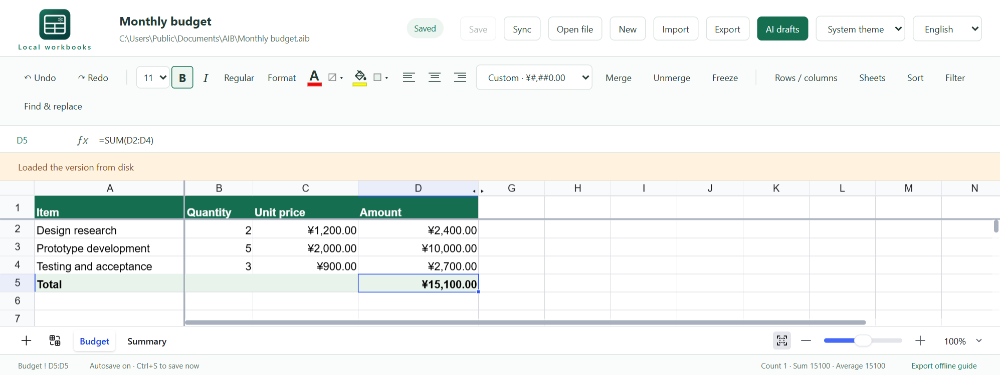
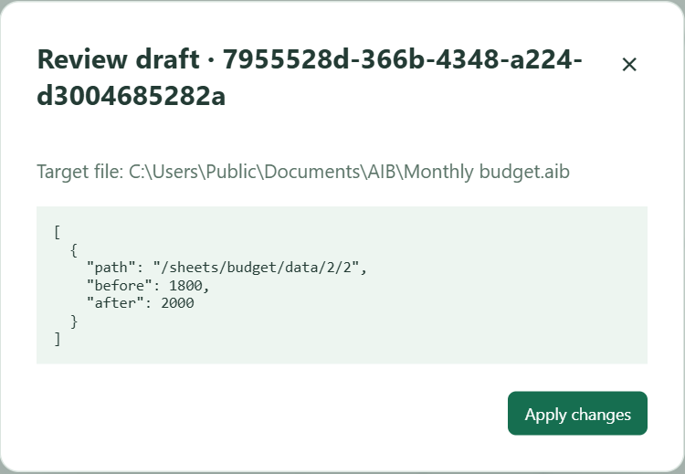

# AI Spreadsheet · A local spreadsheet built for AI

[简体中文](README.zh.md) · [](https://github.com/Changdw/ai-spreadsheet/actions/workflows/verify.yml)

**Double-click a budget and you see cells and formulas. Give the same file to your AI assistant and it sees JSON.** One `.aib` holds the whole workbook. Drag to fill a column, format a price and let the local web editor autosave. Your agent can read just the cells it needs and leave you a draft to review.

**[View the read-only demo](https://changdw.github.io/ai-spreadsheet/en/)** · **[Download for Windows (x64)](https://github.com/Changdw/ai-spreadsheet/releases/latest/download/ai-spreadsheet-windows-x64.zip)** · **[Download for macOS (Apple silicon)](https://github.com/Changdw/ai-spreadsheet/releases/latest/download/ai-spreadsheet-macos-arm64.zip)**

[](https://changdw.github.io/ai-spreadsheet/en/)

[See the budget as JSON](examples/budget.aib) · [Give your agent the offline guide](skills/aib-workbook/references/en/aib-offline.md)

## Ask your agent to revise a quote

> “Raise the unit price for prototype development from 1,800 to 2,000. Show me the change first.”

Try it with the sample budget and its [example edit](examples/change-budget.json). Run `aib draft`, then open **AI drafts**. The diff shows the price in **C3 changing from 1,800 to 2,000**, and the original total is still **14,100**. Click **Apply changes** and the five units add 1,000 to the budget. Both the total in D5 and the linked summary sheet now show **15,100**.

<details>
<summary>See the draft and try the same edit</summary>



Open the sample workbook from your source checkout in the workbench. In that checkout, run the following command, then click **AI drafts**.

```sh
npm run --silent aib -- --offline draft examples/budget.aib --ops examples/change-budget.json
```

</details>

Hand the [offline guide](skills/aib-workbook/references/en/aib-offline.md) to your own agent. It covers creating a workbook, reading ranges, proposing edits and verifying calculated values. Sheets, data rows, formulas and styles are fields in a single UTF-8 text file, so you can review their changes in Git, too.

## How much of a 1.2-million-cell sheet does an agent need?

| What we tried | What we measured |
| --- | --- |
| Read the last six cells, `J99999:L100000`, from a 100,000-row × 12-column numeric sheet | **9.59 MB** on disk. The values array returned by the CLI was **53 bytes** and can be passed directly to the model. |
| Display the same workbook in the browser | **2.29 seconds** from navigation to a visible grid, with the workbook already open on the local server. Median of three runs. |
| Calculate 10,000 `SUM` formulas in a separate workbook | **0.81 seconds** for the calculation step alone in one engine run. |

The 53 bytes are the UTF-8 length of the array below. The full CLI response also includes the file path and revision hash.

```json
[[1199985,1199986,1199987],[1199997,1199998,1199999]]
```

Measured on Windows x64 with an Intel Core i9-14900HX, Node.js 24.22.3 and Edge. [Fixture and calculation script](https://github.com/Changdw/ai-spreadsheet/blob/main/scripts/benchmark.ts) · [Browser timing script](https://github.com/Changdw/ai-spreadsheet/blob/main/scripts/benchmark-ui.ts)

<details>
<summary>Reproduce the six-cell read after running npm ci in a source checkout</summary>

```sh
node --import tsx scripts/benchmark.ts 100000 12 values
npm run --silent aib -- --offline read .verification/benchmark-values-100000.aib --sheet Sheet1 --range J99999:L100000
```

</details>

## Open your first workbook

Choose your platform above and extract the ZIP. Both downloads work without signing in to GitHub. [Release notes and checksums](https://github.com/Changdw/ai-spreadsheet/releases/latest)

| Platform | One-time setup |
| --- | --- |
| Windows x64 | Run `Install.ps1` in the extracted folder. Right-click an `.aib` workbook, choose **Open with**, select `AIB.exe` and choose **Always**. |
| macOS on Apple silicon | Select an `.aib` in Finder. Under **Get Info → Open with**, choose `AIB.app`, then **Change All**. |

Now double-click an `.aib` file. AIB starts the local workbench and opens that workbook in your default browser. To try the example above, download the [sample budget](examples/budget.aib) to your documents folder and double-click it.

**Bring an existing spreadsheet or share the result.** Import XLSX, XLS or CSV. Export an Excel workbook, a single sheet as CSV, or a read-only HTML snapshot that colleagues can open offline or embed in another page. The HTML opens without a running AIB server. [Format and conversion details](docs/guide/en/usage.html)

## Documentation

| Task | Entry point |
| --- | --- |
| Open and edit a budget | [Quick start](docs/guide/en/aib-quickstart.html) |
| Use the workbench, CLI, npm tests and release scripts | [User guide](docs/guide/en/usage.html) |
| Install, build and troubleshoot | [Installation](docs/guide/en/installation.html) |
| Understand dependencies and file ownership | [Architecture](docs/guide/en/architecture.html) |
| Give an agent the format and conversion recipes | [Offline Markdown guide](skills/aib-workbook/references/en/aib-offline.md) |

Open the HTML documents locally after cloning.

## Run from source

Use Node.js 24.x with npm. Windows portable builds include the runtime.

```sh
npm ci
npm run build
npm run aib -- open examples/budget.aib
```

## Work with an agent

```sh
npm run --silent aib -- --offline context examples/budget.aib
npm run --silent aib -- --offline read examples/budget.aib --sheet "预算" --range D5 --calculated
npm run --silent aib -- --offline draft examples/budget.aib --ops examples/change-budget.json
```

Use the returned draft ID with `diff`, `draft-validate` and `apply`. Direct edits can supply `batch --expected-hash` to check the workbook revision. The sample's sheet name `预算` means “Budget”. The schema preserves sheet IDs, formulas and typed literals, including leading-zero identifiers. Check the conversion-loss report when exchanging files with other formats.

**Development** · `npm run check` runs type, unit, documentation, build and browser checks. `npm run release:win` and `npm run release:mac` build local distribution archives on their respective platforms. Browser tests use Edge on Windows. Install Playwright Chromium on other platforms.

**Contributing** · Open an issue for a bug or a feature request. To contribute a change, create a branch from `main` in your fork and open a pull request against `main`. Include the behavior change and how you tested it. AIB CI tests and packages the app on Windows x64 and macOS arm64. Each successful platform job attaches its ZIP to the Actions run.

**License** · AIB’s own code uses the [MIT license](LICENSE). In the distribution archive, `dependencies.json` indexes the notices under `licenses/`. The Node.js notices are in `NODE-LICENSE.txt`. © 2026 AIB contributors.

AIB is an independent project. Microsoft and Excel are trademarks of the Microsoft group of companies.
