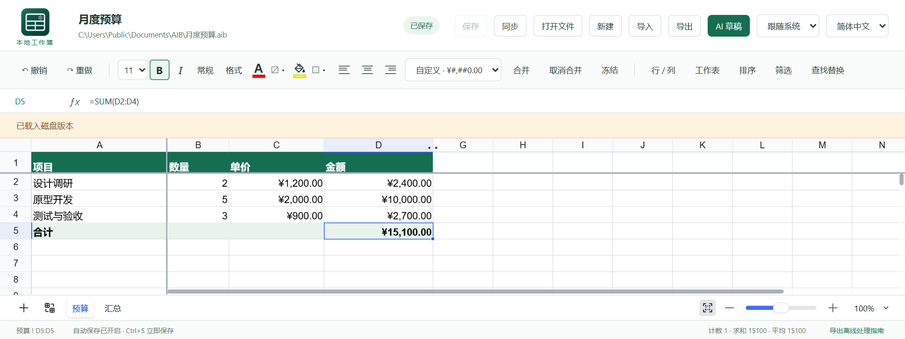
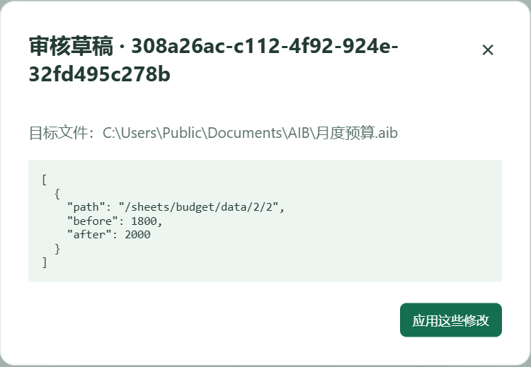

# AIB Spreadsheet · 为 AI 设计的本地表格工作台

[English](README.en.md) · [中文使用与开发指南](README.zh.md) · [](https://github.com/Changdw/aib-spreadsheet/actions/workflows/verify.yml)

**双击一份预算表，你看到的是单元格和公式。把同一个文件交给 AI，它读到的是 JSON。** 一份 `.aib` 就装下整本工作簿。你可以在本地浏览器里拖动填充、改格式，让工作台自动保存。也可以让自己的 AI 助手只读几格、起草修改，再由你决定是否应用。

[下载 Windows / macOS 便携版](https://github.com/Changdw/aib-spreadsheet/actions/workflows/verify.yml?query=branch%3Amain) · [打开预算样例看 JSON](examples/budget.aib) · [给 AI 的离线指南](skills/aib-workbook/references/zh/aib-offline.md)



## 试试让 AI 改一次报价

> “把「原型开发」的单价从 1,800 调到 2,000，先给我看差异。”

仓库里有这份预算和对应的[示例修改](examples/change-budget.json)。用 `aib draft` 生成草稿后，打开工作台的「AI 草稿」，就能看到 **预算!C3 的单价从 1,800 改为 2,000**。这是唯一一处修改，此时原表合计仍是 **14,100**。点击「应用这些修改」，5 件原型开发的预算随之增加 1,000，「预算」的合计与「汇总」的总预算一起变成 **15,100**。

<details>
<summary>看草稿差异截图，自己生成同一份草稿</summary>



用工作台打开源码目录里的样表后，在同一目录运行下面的命令，再点击「AI 草稿」查看。

```sh
npm run --silent aib -- --offline draft examples/budget.aib --ops examples/change-budget.json
```

</details>

自己的助手也能走通这套流程。给它[离线指南](skills/aib-workbook/references/zh/aib-offline.md)，它就有了创建工作簿、读指定范围、提交草稿和验算公式的格式说明与命令。工作表、数据行、公式和样式都是同一份 UTF-8 文本里的字段，改动也能在 Git 里审阅。

## 一张 120 万格的表，AI 需要读多少？

| 我们实际做了什么 | 测到了什么 |
| --- | --- |
| 在 10 万行 × 12 列的数字表里读取末尾六格 `J99999:L100000` | 整份文件 **9.59 MB**。CLI 返回的数值数组只有 **53 字节**，可以单独传给模型。 |
| 在浏览器打开同一张表 | 本地服务已打开工作簿，从页面导航到表格可见，中位数 **2.29 秒**（3 次）。 |
| 在另一张表计算 10,000 个 `SUM` 公式 | 公式引擎完成计算用时 **0.81 秒**（单次，单独计时）。 |

53 字节是下面这个数组的 UTF-8 长度。完整 CLI 响应还带文件路径和版本哈希。

```json
[[1199985,1199986,1199987],[1199997,1199998,1199999]]
```

测试环境为 Windows x64、Intel Core i9-14900HX、Node.js 24.22.3，浏览器使用 Edge。[样表生成与计算脚本](https://github.com/Changdw/aib-spreadsheet/blob/main/scripts/benchmark.ts) · [浏览器计时脚本](https://github.com/Changdw/aib-spreadsheet/blob/main/scripts/benchmark-ui.ts)

<details>
<summary>复现这次六格读取（在源码目录运行 npm ci 后执行）</summary>

```sh
node --import tsx scripts/benchmark.ts 100000 12 values
npm run --silent aib -- --offline read .verification/benchmark-values-100000.aib --sheet Sheet1 --range J99999:L100000
```

</details>

## 第一次打开 AIB

登录 GitHub，在上方下载链接选一次成功的 `main` 构建，在 **Artifacts** 下载对应平台的压缩包并解压。

| 平台 | 首次设置 |
| --- | --- |
| Windows x64 | 在解压目录运行 `Install.ps1`，右键一份 `.aib` →「打开方式」→ 选择 `AIB.exe` →「始终」。 |
| macOS（Apple 芯片） | 在 Finder 选中一份 `.aib` →「显示简介」→「打开方式」→ 选择 `AIB.app` →「全部更改」。 |

现在双击一份 `.aib`，AIB 会自动启动本地工作台，在默认浏览器里打开这份表。想试试上面的预算？把[预算样表](examples/budget.aib)下载到自己的文档目录，双击即可。开发者也可以安装 Node.js 24，在源码目录直接运行下面三条命令。

```sh
npm ci
npm run build
npm run aib -- open examples/budget.aib
```

**已有表格可以直接带进来。** 工作台和 CLI 都能导入 XLSX、XLS 和 CSV，导出时可选 XLSX、XLS 或单表 CSV。分享给同事时，还可以导出一份只读 HTML，双击就能看，也能嵌进项目文档。阅读这份 HTML 无需运行 AIB。[格式与转换说明](docs/guide/zh/usage.html)

[快速上手](docs/guide/zh/aib-quickstart.html) · [安装与排错](docs/guide/zh/installation.html) · [开发、测试与贡献](README.zh.md) · [MIT 许可证](LICENSE)
